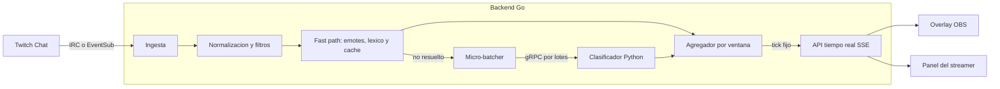

# Arquitectura

Volver a [[00-Home]]. Contratos detallados en [[06-Contratos-e-Integracion]].

## Componentes
| Componente   | Tecnología                | Responsabilidad                                                               | Nota                             |
| ------------ | ------------------------- | ----------------------------------------------------------------------------- | -------------------------------- |
| Backend      | Go                        | Ingesta de Twitch, preprocesado, orquestación, agregación, API en tiempo real | [[03-Backend-Go]]                |
| Clasificador | Python (v1, reemplazable) | Convertir texto en probabilidades de emoción                                  | [[05-Clasificador-de-Emociones]] |
| Frontend     | Vite + TypeScript         | Overlay para OBS y panel del streamer                                         | [[04-Frontend-Vite]]             |

> [!tip] Sobre el nombre "agente"
> El componente de IA que clasifica es en realidad un **servicio de inferencia**: recibe texto, devuelve probabilidades. No decide ni ejecuta acciones. Si en el futuro se vuelve un agente (por ejemplo, resúmenes del chat con un LLM), se documenta aparte. Por claridad lo llamamos "clasificador".

## Flujo de datos



## Cómo funciona por dentro (paso a paso)
1. **Ingesta:** el backend mantiene la conexión al chat y emite cada mensaje con una marca de tiempo de llegada (se usa para medir latencia).
2. **Normalización y filtros:** limpia texto, extrae emotes, descarta comandos (`!algo`) y bots conocidos, colapsa repeticiones (copypasta) y limita el peso por usuario para que una sola persona no domine la lectura.
3. **Fast path:** los mensajes cuya emoción se puede resolver barato (solo emotes, léxico conocido, o un texto ya visto en caché) **no llegan al modelo**.
4. **Micro-batcher:** agrupa los mensajes restantes durante una ventana corta (por tamaño o por tiempo, lo que ocurra primero) y los envía al clasificador en un solo llamado.
5. **Clasificador:** devuelve probabilidades por emoción para cada mensaje.
6. **Agregador:** combina las predicciones en una ventana deslizante con peso decreciente por antigüedad. Calcula emoción dominante, distribución, intensidad y tendencia.
7. **Emisión por tick:** cada intervalo fijo (por ejemplo 500 ms) se publica el estado actual a los clientes conectados, **independientemente** de cuántos mensajes entraron. Esto desacopla el ritmo del chat del ritmo de la interfaz.
8. **Frontend:** recibe el estado por SSE y anima la aguja con interpolación suave.

## Decisiones de diseño clave
- **Muestreo bajo carga:** si la cola se satura, se descartan mensajes (preferentemente los más antiguos). Estadísticamente el termómetro sigue siendo válido. Ver [[07-Latencia-y-Rendimiento]].
- **Colas acotadas** entre etapas para evitar crecimiento de memoria y latencia acumulada (*backpressure* explícito).
- **Clasificador como servicio separado** para poder cambiar de lenguaje o de modelo sin tocar el backend: [[0004-clasificador-servicio-separado]].
- **Modo degradado:** si el clasificador no responde, el backend sigue con la lectura de emotes y léxico y marca `degraded: true` en el estado emitido.
- **Estado en memoria:** v1 no requiere base de datos. Ver [[08-Datos-y-Almacenamiento]].

## Estructura propuesta del repositorio (monorepo)
```
chat-emotion-meter/
├── backend/          # Go
├── frontend/         # Vite + TS
├── classifier/       # Python (v1)
├── proto/            # Contratos gRPC (fuente de verdad)
├── deploy/           # docker-compose y configuración
├── loadtest/         # Escenarios de carga y simulador de chat
├── docs/             # Este vault de Obsidian
├── openspec/         # Especificaciones y cambios
├── .github/          # Workflows, plantillas de issue y PR
├── AGENTS.md
├── CONTRIBUTING.md
└── README.md
```
Razón del monorepo: [[0001-monorepo]].

## Vista de despliegue
Dos imágenes en producción: **app** (backend Go que sirve también el frontend ya compilado) y **classifier**. Ver [[09-Despliegue-Docker]].
